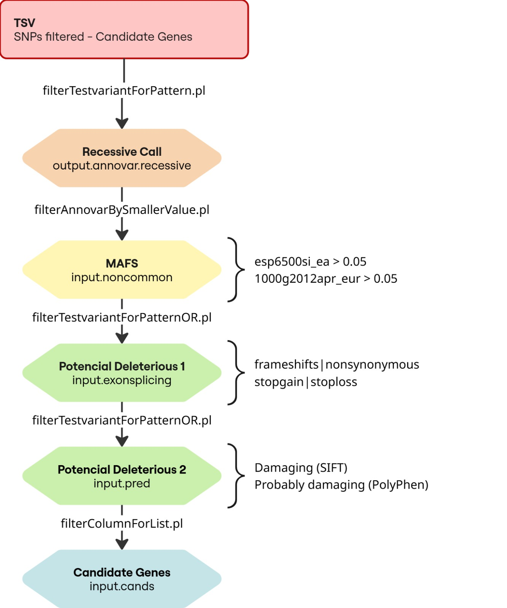
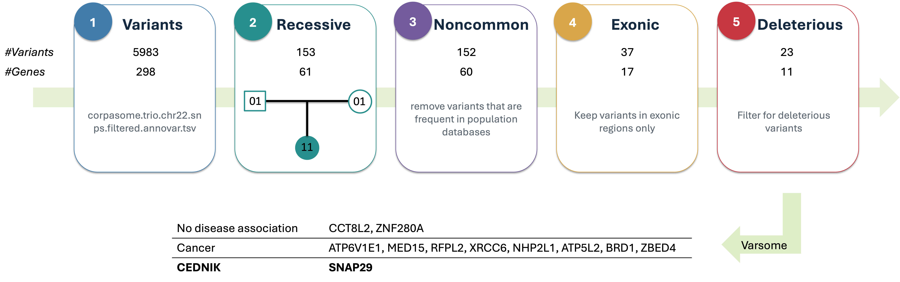
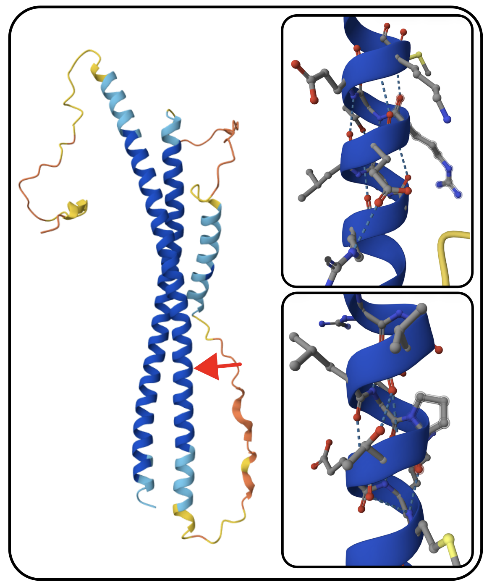

```{r libraries, include = FALSE}
#setting up libraries
library(tidyverse)
library(ggplot2)
library(gt)
library(kinship2)
library(knitr)

#load table for the variants
variants <- read_tsv("data/corpasome.trio.chr22.snps.filtered.annovar.tsv", col_types = cols(clinvar_20140702 = "c"))

```

## Index

```{r}
# Table
index_df <- data.frame(
  Contents = 
    c("1. Index", "2. Introduction", "3. Materials and Methods", "4. Results","5. Discussion","6. References", "7. Appendix")
)

kable(index_df)
```

## Introduction

Neurocutaneous syndrome, characterized by cerebral dysgenesis, neuropathy, ichthyosis, and keratoderma, or CEDNIK syndrome for short, is a autosomal recessive genetic disorder [@hsu2017cednik]. This disease is caused by a loss-of-function variant in SNAP29 (synaptosomal-associated protein 29), which encodes a SNARE protein, a vesicular membrane fusion protein [@schiller2016establishment]. Symptoms of the disease are Microcephaly, Global developmental delay, Ataxia, Ichthyosis, Diffuse palmoplantar hyperkeratosis.

This syndrome was first discovered in 2005— within the 22q11.2 region and the SNAP29 gene —using homozygosity mapping on two unrelated families with a history of consanguineous marriage that exhibited similar symptoms [@sprecher2005mutation]. In the subsequent years, up to 2021, nearly 20 variants of this syndrome were discovered [@mah2021new].

CEDNIK syndrome is an extremely rare disorder, with an estimated prevalence of less than 1 per 1,000,000 individuals; a reliable population-based incidence has not been established due to the small number of reported cases [@orphanetcednik].

Variant detection and diagnosis have become much more accessible with the advent of next-generation sequencing (NGS). Unlike earlier sequencing technologies, NGS enables the simultaneous analysis of anything from a few genes to hundreds of genes, the entire exome, or even the whole genome. NGS systems employ approaches such as whole-genome sequencing (WGS) and whole-exome sequencing (WES) [@brancato2025ngs].

In this report, we focus on WES because CEDNIK syndrome is a Mendelian monogenic disorder, which is why identifying variations within the exons alone is generally sufficient for its detection. In the case we analyzed, a 3-year-old girl exhibited symptoms of the syndrome while her parents were healthy. Therefore, our objective was to perform WES for this family of three and identify the variant by comparing the results against the reference human genome (GRCh37/hg19). This type of analytical method is known as "trio analysis" [@gabriel2022trio], and given that this syndrome is an autosomal recessive disorder, we can infer that both parents are heterozygous carriers [@hsu2017cednik].

## Materials and methods

### Study Participants & Whole exome sequencing

The base of our work is publicly available genetic data from a Spanish family, here consisting of a father, mother and their daughter, referred to as "the Corpasome" [@corpas_crowdsourced_2015]. In our case the genome of the daughter is synthetically altered and a disease phenotype called CEDNIK Syndrome, caused by these alterations, is diagnosed. Main symptoms are developmental delay and skin disorder. The latter mainfasting at the age of two in ichthyosis and thickening of palms and soles. Further, she has been diagnosed with microcephaly and poor motor development as well as impaired coordination. As CEDNIK Syndrome is an autosomal recessive inheritable disease and the parents are healthy, the father and mother both have one chromosome with the disease-causing variant and one without. After deciding to make their genomes publicly available, the Corpas family bought direct-to-consumer sequencing privately to collect DNA in saliva using Oragene kits. Exomes were captured with Agilent SureSelect Human All Exon (44 Mb design) and sequenced on Illumina HiSeq with an average coverage of about 30x over the target region.

```{r}
#| warning: false
#| label: fig-pedigree
#| fig-cap: "Family trio pedigree"
#| out-width: "80%"

#draw pedigree for corpasome family
ped <- read_table("data/corpasome.ped",
                  col_names = c("family", "id", "father", "mother", "sex", "phenotype"),
                  col_types = "ccccii")

ped2 <- ped |>
  mutate(across(c(id, father, mother), str_remove, pattern = "^corpasome_"),
         father   = na_if(father, "0"),    
         mother   = na_if(mother, "0"),
         affected = as.integer(phenotype == 2)) 

pedi <- pedigree(id      = ped2$id,
                 dadid   = ped2$father,
                 momid   = ped2$mother,
                 sex     = ped2$sex,        
                 affected = ped2$affected)

plot(pedi)
```

### NGS data preprocessing

Next-Generation Sequencing (NGS) data pre-processing was used to refine and align the raw reads given to downstream Whole-Exome Sequencing (WES) analysis. The general process follows a read of qualities, the realignment and mapping of the genomes, then the variant callings and finally the analysis of the Candidate Genes, as described in the @fig-organigram .

The input data set comprised individual files corresponding to the family trio: mother, father, and affected child, from the Corpasome family. They are organized for each person as as paired-ends reads, 150 bp per read for R1 and R2. The given input is a .fq file form from each member of the trio. To graph and see the organization of the sequences, GC percentage and the quality scores, we search through the FastQC Report (version 0.12.1). This .fqc files were significant to identify technical artifact sequencing errors or contamination on the samples and reads. The primary QC metrics perfomed were:

- Per-base sequence quality: The Q-scores graphs above 30x threshold (Q30) validation, in acordance to the standart Illumina quality trimming sequence logarithm[@illumina].

- Reads Lenght: To confirm the expected paired-end bases for each read.

- Overexpressed sequences: To detect residual adapters contamination at the PCR preparation. This helps trimming the sequence to prevent miss-alignments.

- Sequence duplication levels: It estimates the library complexity and detect potencial PCR bottlenecking. This helps to avoid the false-positive identification of heterozygous variants.

To process the alignments, the “Burrows-Wheeler Aligner (bwa mem)”[@li2009fast] tool converts our .fq files into .bam/.sam files by comparing the qualities and positions against a reference genome; which, for this study was hg19. With the binary version (.bam), we can easly access to specific genomic regions using index files (.bai), allowing the reads of each family member to be processed and indexed efficiently in the vcf files.

For each part of the mapping and index findings, we required different tools like gatk3 and samstools. First we mark the duplicates form each read vs the chr22 found in the hg19. This will help us to realign and target indels from miss coding quality scores and correct for mapping errors[@gatk_best_practices]. The given scores are proven by the RealignerTargetCreator and IndelRealigner tools. The given files were recalibrated based on their basecalling scores (BSQR) for avoiding false positives in the variant calling. The samples for this realignment are taken from the dbsnps of the ch22 of the hg19 and the Mills and Devine y el 1000 Genomes Project indels for the build 37 file in the ch22; taken from the golden standart archives of gatk3 (Resource bundle 2016 version) [@gatk_resource_bundle].

To prepare for the variant callings, first we proceed to eliminate the reads mistakes by taking in account a coverage calculation. Using the tool DepthOfCoverage by Gatk3 the analysis assessed target regions form the ch22.bed exons file against our reads .bam file. This step helps to calculate the proportion of target bases on specific depth of coverage thresholds (1x,5x,10x,20x and 50x)[@gatk_depth_of_coverage].

Using the refined regions of interest, we call the bcftools and samstools to perform variant calling on the BAM files. This tools performs, after pilling up the reads in one file, a calling form the variants based on the "c-g" genotypes into .bcf files. Then, the samstools performs a filtering for a .vcf archive with the variants above the 20x coverage for future analysis[@bcftools_docs].

To refine the variant selection for functional analysis, as shown in @fig-organigram, variants were cross-referenced with general and clinical databases based on the hg19 reference genome. This annotation process utilizes the ANNOVAR (v. 2014-07-02) tool to integrate European population frequencies (1000g2012apr_eur and esp6500si_ea), common variant identifiers (snp138), pathogenicity prediction scores (ljb2_stift and ljb2_pp2hvar)[@ng2003sift] [@adzhubei2010method], and clinical relevance databases (clinvar_20140702)[@clinvar_intro];more information in @tbl-databases. By combining these anotations, the data merges into a readable table in .tsv format that contains genetic annotations, known identifiers, predictive scores, clinical relevance, and genomic coordinates [@wang2010annovar].

```{r}
#| label: fig-organigram
#| fig-cap: "Precise filtering workflow [Elaborated by the authors]"
#| fig-alt: "Filtering process workflow"
#| warning: false

include_graphics("organigram_full_flow.jpg")
```

Data processing, pipeline execution, and analytical workflows were performed using a custom shell script (runAnalysis.sh) executed within a Bash command-line interface. The computational environment was managed via "Conda" [@conda_docs]. Operations and remote server connections were conducted using MobaXterm Personal Edition (v26.5), utilizing datasets and reference databases provided by the instructional program.

### Variant annotation and filtering

With the uptake of the resultant .tsv file, we proceed for the variant annotations. Through the ANNOVAR filtering flow seen in the @fig-organigram, we analize the functional consequences and clinical relevance of identified single nucleotide polymorphisms (SNPs) and insertions/deletions (indels). The classification of the variants are listed in the following columns:

```{r}
#| label: tbl-databases
#| tbl-cap: "Reference databases used in the variant filtering by Annovar and perl process"
#| echo: false
library(tibble)
library(knitr)
# Table
f_database <- tibble(
  Resource = c(
    "refGene (hg19)", 
    "1000 Genomes (`1000g2012apr_eur`)", 
    "ESP6500 (`esp6500si_ea`)", 
    "dbSNP (`snp138`)", 
    "SIFT (`ljb2_sift`)",
    "PolyPhen-2 (`ljb2_pp2hvar`)",
    "ClinVar (`clinvar_20140702`)"
    ),
  Column = c(
    "col 7",
    "col 11",
    "col 12",
    "col 13",
    "col 14",
    "col 15",
    "col 16"
    ),
  Pipeline = c(
    "Primary reference genome for the functional annotation of genetic variants (SNPs and indels).",
    "Reference transcript database used to determine genomic and exonic context.",
    "Population allele frequencies (global and European) utilized to filter out common variants and isolate rare ones.",
    "NCBI Standart Catalog of human genetic variations, SNPs polymorphisms.",
    "Sorting Intolerant From Tolerant, bioinformatic reference for missense and nonsynonnimous mutations identifiers.",
    "Bioinformatics tools for predicting possible impact of an amino acid substitution on the structure and function of a human protein.",
    "Clinical database linking genetic variants to human health conditions and clinical interpretations."
  )
)

kable(f_database, format = "markdown")
```

For the recessive inheritance model, variants were filtered using a custom Perl script tool: filterTestvariantForPattern.pl. For the Recessive Calling, this tools helps to find and anexate in our .tsv table a list of mendelian herencies patrons columns from the genotipes of the family (see @fig-organigram2). Both unaffected parents were heterozygous carriers present the patron “01” and the affected compound heterozygous genotype “11”. With this we will isolate candidate variants following an autosomal recessive mode of inheritance within the family trio. In our trial, after filtering the table in R for the candidate genes, we verify that is a recessive kind of disease.

```{r}
#| label: fig-organigram2
#| fig-cap: "Variant Anotation filters for a recessive model"
#| fig-alt: "Filtering process workflow"
#| out-width: "70%"
#| warning: false

library(knitr)

```

For the second filtering step, variants were filtered based on Minor Allele Frequencies (MAFs) to exclude common polymorphisms. Specifically, we retained variants with an allele frequency below the 5% (0.05) threshold in our .tsv table. This filtering was performed using the ANNOVAR tool filterAnnovarBySmallerValue.pl, referencing the esp6500si_ea and 1000g2012apr_eur databases to identify and remove common genomic regions (@fig-organigram2).

To narrow down the new selection of genes (already around 60 candidates), the data was filtered in two main steps. First, deleterious variants were identified by comparing them against SNP databases to retain regions causing frameshifts, nonsynonymous changes, stopgains, and stoplosses, using snp138 as a reference. In the second phase, the SIFT and PolyPhen-2 databases will filter out benign variants, thereby retaining only those predicted to be damaging or probably damaging.

Finally, surviving Candidate Genes (11 gene variants) were cross-referenced with disease databases (such as ClinVar and OMIM) and prioritized based on their biological plausibility and compatibility with the patient's clinical description and associated Human Phenotype Ontology (HPO) terms.

### Reference R Packages

As seen in @fig-organigram2 , the filtering steps could have been pre-selected using the ANNOVAR tools within the Bash (MobaXterm) environment. However, for the purposes of this project, we performed the database filtering using RStudio and the R programming language on the .tsv dataset. For this implementation, the following R packages were required:

```{r}
#| label: tbl-packages
#| tbl-cap: "R data analyst packages used"
#| echo: false

# Table
f_references <- tibble(
  Resource = c(
    "tidyverse", 
    "ggplot2", 
    "ESP6500 (`esp6500si_ea`)", 
    "dbSNP (`snp138`)", 
    "SIFT (`ljb2_sift`)",
    "PolyPhen-2 (`ljb2_pp2hvar`)",
    "ClinVar (`clinvar_20140702`)"
  ),
  Column = c(
    "col 7",
    "col 11",
    "col 12",
    "col 13",
    "col 14",
    "col 15",
    "col 16"
  ),
  Pipeline = c(
    "Primary reference genome for the functional annotation of genetic variants (SNPs and indels).",
    "Reference transcript database used to determine genomic and exonic context.",
    "Population allele frequencies (global and European) utilized to filter out common variants and isolate rare ones.",
    "NCBI Standart Catalog of human genetic variations, SNPs polymorphisms.",
    "Sorting Intolerant From Tolerant, bioinformatic reference for missense and nonsynonnimous mutations identifiers.",
    "Bioinformatics tools for predicting possible impact of an amino acid substitution on the structure and function of a human protein.",
    "Clinical database linking genetic variants to human health conditions and clinical interpretations."
  )
)

kable(f_database, format = "markdown")

tidy <- citation("tidyverse")
print(tidy,
      bibtex=FALSE)
#citation("ggplot2")
#citation("gt")
#citation("kinship2")
#citation("knitr")
#citation("tibble")
```

## Results

### QC

```{r}
#| label: tbl-fastqc
#| tbl-cap: "FastQC summary for each read in each sample"
#| echo: false
#summarize fastqc data

# save fastqc directory
fastqc_base_dir <- "data/fastqc/"

valid_dirs <- str_subset(dir(fastqc_base_dir), "fastqc$")

processed <- read_tsv(str_c(fastqc_base_dir, 
                            valid_dirs, 
                            "/fastqc_data.txt"), 
        col_names = TRUE, 
        skip = 2, 
        n_max = 8,
        id = "file_name_long", 
        show_col_types = FALSE) |> 
  mutate(file_name = str_extract(file_name_long, "/([^/]+?)_", group = 1), .before = file_name_long) |> 
  select(!file_name_long) |> 
  pivot_wider(id_cols = file_name, names_from =`#Measure` , values_from = Value) |> 
  select(Filename, `Total Sequences`, `Total Bases`, `Sequence length`, `%GC`) 

gt(processed)
```

To begin the WES analysis, it is important to build on raw-read data that fulfills the quality requirements. By assessing the quality of the fastq file, it can be assured that later interpretation is not based on technical errors. Regarding the Corpasome data displayed in @tbl-fastqc, the sequence length for all samples is as expected as well as the GC percentage with small variations in the reads of the mother displaying a 44% compared to 45% in the father and daughter. The number of total sequences as well as the number of bases measured is the same for read 1 and read 2 in each family member, whereas the number varies between different persons. The maximal difference can be found between the father and the daughter with 39.9 Megabase pairs (Mbp) for the dad and 33.6 Mbp in the daughter's samples.

```{r}
#| label: fig-quality
#| fig-cap: "Heatmap of the quality control status performed by FastQC tool"
#| warning: false
#| echo: false

# Evaluate all QC metrics
# reads summary file from each fastqc folder and combines them in one table --> returns PASS, WARN or FAIL

# Read all summary.txt files into one long table (Status, Metric), "path" records the source file
smry <- list.files(fastqc_base_dir, pattern = "summary.txt$", recursive = TRUE, full.names = TRUE) |>
  read_tsv(col_names = c("Status", "Metric", "file"), id = "path", show_col_types = FALSE) |>
  mutate(sample = path |> 
           dirname() |> 
           basename() |>
           str_replace("^([^.]+)\\..*\\.(\\d+)_fastqc$", "\\1_\\2"), Metric = fct_rev(fct_inorder(Metric)))   

#Visualize heatmap with one tile per sample and module
ggplot(smry, aes(x = sample, y = Metric, fill = Status)) +
  geom_tile(color = "white", linewidth = 0.5) +
  scale_fill_manual(values = c(PASS = "darkgreen", WARN = "orange", FAIL = "red")) +
  labs(title = "Quality metrics per set", x = NULL, y = NULL) +
  theme_minimal()
```

@fig-quality summarizes different quality metrics across the fastqc files. For most of the metrics the data passes the quality criteria. Regarding the per tile sequence quality, all samples fail which in this case is not unexpected because the Corpasome data has been sequenced in 2012 [@corpas_crowdsourced_2015]. Besides that, the metric expresses a warning for the "per sequence GC content" which controls the measured sequences for the biologically expected distribution of Guanine and Cytosine.

```{r}
#| label: fig-SequenceEvaluation
#| fig-cap: "Guanine-Cytosine distribution per sequence and sample"

#GC content in more detail
# read one FastQC module by name
read_module <- function(file, module) {
  lines <- readLines(file)
  start <- which(startsWith(lines, str_c(">>", module, "\t")))
  end   <- which(lines == ">>END_MODULE")
  end   <- end[end > start][1]
  read_tsv(I(str_c(lines[(start + 1):(end - 1)], collapse = "\n")),
           show_col_types = FALSE) |>
    rename_with(\(x) str_remove(x, "^#"))
}

files <- list.files(fastqc_base_dir, pattern = "fastqc_data.txt",
                    recursive = TRUE, full.names = TRUE)

gc <- files |>
  set_names() |>
  map(\(f) read_module(f, "Per sequence GC content")) |>
  list_rbind(names_to = "file") |>
  mutate(folder = basename(dirname(file)),
         sample = str_extract(folder, "^[^.]+"),  
         read   = str_c("Read ", str_extract(folder, "(\\d+)_fastqc$", group = 1))) |>
  group_by(folder) |>
  mutate(proportion = Count / sum(Count)) |>  
  ungroup()

ggplot(gc, aes(`GC Content`, proportion, colour = sample, linetype = read,
               group = folder)) +
  geom_line(linewidth = 0.8) +
  scale_x_continuous(limits = c(0, 100), breaks = seq(0, 100, 10)) +
  labs(title = "GC content distribution per sequence",
       x = "Mean GC content per read (%)", y = "Proportion of reads",
       colour = "Sample", linetype = NULL) +
  theme_minimal()
```

@fig-SequenceEvaluation further inspects the GC content across the three samples. It shows that the peak for GC contents is slightly shifted for samples of the mother. Still the distribution is the same for the two reads and the deviations between the samples are small.

Visualization of per-sequence GC content demonstrates consistent profiles across all three family members, showing stable distributions between forward and reverse reads. While a minor peak shift is observed in the maternal sample, the deviations are minimal and do not suggest technical failure.

```{r qc_boxplots}
#| label: fig-boxplots
#| fig-cap: "Per-base sequence quality distribution showing acceptable scores across all samples and reads"

#genereate qc visualization with all pb_qual files

files <- list.files(fastqc_base_dir, pattern = "fastqc_data.txt",
                    recursive = TRUE, full.names = TRUE)

qc <- files |>
  set_names() |>
  map(\(f) read_tsv(f, skip = 13, n_max = 50, show_col_types = FALSE)) |>
  list_rbind(names_to = "file") |>
  mutate(folder      = basename(dirname(file)),
         read_set    = str_c("Read ", str_extract(folder, "(\\d+)_fastqc$", group = 1)),
         sample      = str_remove(folder, "\\.\\d+_fastqc$"),
         base_factor = factor(`#Base`, levels = unique(`#Base`)),
        panel = str_c(str_extract(folder, "^[^.]+"), "_", str_extract(folder, "(\\d+)_fastqc$", group = 1)),
         panel= factor(panel, levels = c("dad_1", "dad_2", "mom_1", "mom_2", "daughter_1", "daughter_2"))) |>
  select(!file)

qc |>
  group_by(folder) |> 
  mutate(`#Base` = factor(`#Base`, levels = `#Base`)) |> 
  
  #generate boxplot
  ggplot(aes(x = base_factor, y = Mean, fill = read_set)) +
  geom_boxplot(
    aes(
      ymin = `10th Percentile`,
      lower = `Lower Quartile`,
      middle = `Median`,
      upper = `Upper Quartile`,
      ymax = `90th Percentile`), stat = "identity", staplewidth = 0.5, width = 1) +
  
  #add threshold lines
   geom_hline(aes(yintercept = 28),
              linetype = "dashed",
              color = "orange") + 
  geom_hline(aes(yintercept = 20),
             linetype = "dashed",
             color = "red") +
   geom_line(aes(x = base_factor, y = Mean, group = read_set),
              linetype = "solid",
              color = "blue") +
  labs(title = "Quality scores across all bases", x = "Position in read (bp)", y = "Mean Quality Score") +
  theme_minimal() +
  facet_wrap(vars(panel), ncol = 2) + 
  scale_fill_discrete(name = "Folder") + 
  scale_x_discrete(breaks = seq(1, 100, 5)) + 
  coord_cartesian(ylim = c(0, 43)) +
  theme(legend.position = "none")
```

The per-base sequence quality shown in @fig-boxplots for forward and reverse reads across the family trio reveal a typical Illumina quality profile showing optimal scores in the center of the reads and a decreasing quality towards the end of the reads. Especially the maternal sample displays lower quality scores for terminal positions dropping below a Phred score of 20. However, median quality scores across all samples and positions remain above a threshold of 30.

Overall, raw data quality across all three samples is within acceptable range to proceed with downstream analysis. Subsequent evaluation of alignment and coverage metrics will further asses data quality before variant calling.

### Sample processing

```{r}
#| label: tbl-bamstats
#| tbl-cap: "Steps of preprocessing and read removal"
#| echo: false

#summarize preprocessing 

bam_stats <- read_delim("data/bam_statistics.txt", col_names = c("nreads", "file"),  delim = " ", show_col_types = FALSE)

step_labels <- c(
  "bam"         = "Aligned and sorted",
  "markdup.bam" = "Duplicates removal",
  "realn.bam"   = "Indel realignment",
  "recal.bam"   = "Base quality recalibration"
)

bam_base <- bam_stats |>
  mutate(person   = str_extract(file, "^\\w+"),
         bam_step = str_extract(file, "\\D+$"),
         bam_step = str_remove(bam_step, "^\\.")) |>
  pivot_wider(id_cols = -file, names_from = person, values_from = nreads) |>
  rename(Filename = bam_step) |>
  mutate(description = unname(step_labels[Filename]), .after = Filename)

removed_row <- bam_base |>
  filter(Filename %in% c("bam", "recal.bam")) |>
  summarise(across(c(dad, mom, daughter),
                   \(x) x[Filename == "bam"] - x[Filename == "recal.bam"])) |>
  mutate(Filename = "",
         description = "Removed (total)",
         .before = dad)

pct_row <- bam_base |>
  filter(Filename %in% c("bam", "recal.bam")) |>
  summarise(across(c(dad, mom, daughter),
                   \(x) round(100 * (x[Filename == "bam"] - x[Filename == "recal.bam"]) /
                                x[Filename == "bam"], 1))) |>
  mutate(Filename = "",
         description = "Removed (%)",
         .before = dad)


bam_table <- bind_rows(bam_base, removed_row, pct_row) 

gt(bam_table)

#add summary rows below
removed <- bam_table |> filter(description == "Removed (total)")
pct     <- bam_table |> filter(description == "Removed (%)")

pct_range <- range(unlist(pct[, c("dad", "mom", "daughter")]))

#to format numbers in text 
fmt <- \(x) format(x, scientific = FALSE, big.mark = ",", trim = TRUE)
```

@tbl-bamstats displays the different steps of sample processing and the effect on the number of alignments. As expected, only the duplication removal reduces the number of records. In total `r fmt(removed$dad)` alignments have been removed in the sample of the dad, `r fmt(removed$mom)` for the mom and `r fmt(removed$daughter)` for the daughter, which is in a range of `r pct_range[1]`% to `r pct_range[2]`% of all alignments in the unprocessed file.

### Variant calling/filtering

To begin the variant calling, the raw file includes all covered positions in exons which could potentially contain variants. It includes all three samples and displays 1,418,395 positions. After the variant calling 8,803 of these positions are defined as SNPs in the bcf file which is about 0.62% of the positions in the raw file. To refine the variant calling, positions with a read depth below 20 are removed. 5,898 positions remain in the vcf file. These are 5,983 variants if multi-allelic sites are considered and split in separate rows. This process is also called demultiplexing. Further conversion to .tsv and annotation using ANNOVAR, does not change the number of variants. The resulting file with 5,983 variants can now be used for downstream analysis and filtering of possible disease-causing variants.

```{r}
#Analyse transition/transversion ratio and nonsynonymous/synonymous ratio

ts_tv <- variants |> 
  filter(str_detect(Ref, "^[ACTG]$"), str_detect(Alt, "^[ACTG]$")) |>
  group_by(Ref, Alt) |> 
  summarise(Count = n(), .groups = "drop") |> 
  mutate(Type = case_when(
    (Ref == "A" & Alt %in% c("G")) | (Ref == "G" & Alt %in% c("A")) | 
    (Ref == "C" & Alt %in% c("T")) | (Ref == "T" & Alt %in% c("C")) ~ "Transition",
    TRUE ~ "Transversion")) |> 
  arrange(Type, Ref, Alt)

syn_nonsyn <- variants |> 
  filter(ExonicFunc.refGene %in% c("synonymous SNV", "nonsynonymous SNV")) |> 
  group_by(ExonicFunc.refGene) |> 
  summarise(Count = n()) |> 
  mutate(Type = case_when(
    ExonicFunc.refGene == "synonymous SNV" ~ "Synonymous",
    TRUE                                   ~ "Nonsynonymous")) |> 
  ungroup() |> 
  select(Type, Count) |> 
  arrange(Type)

#Transition/transversion
n_ts <- sum(ts_tv$Count[ts_tv$Type == "Transition"])
n_tv <- sum(ts_tv$Count[ts_tv$Type == "Transversion"])
ts_tv_ratio <- round(n_ts / n_tv, 2)

#Nonsynonymous/synonymous
n_syn    <- syn_nonsyn$Count[syn_nonsyn$Type == "Synonymous"]
n_nonsyn <- syn_nonsyn$Count[syn_nonsyn$Type == "Nonsynonymous"]
nonsyn_syn_ratio <- round(n_nonsyn / n_syn, 2)
```

Besides ensuring sufficient read depth, the transition-transversion ratio as well as the nonsynonymous/synonymous SNP ratio are quality metrics to control for correct variant calling Since transitions require less energy, the ratio of transition-transversion is expected to be \> 2 which is also reflected in the data presenting a ratio of `r ts_tv_ratio` (see @tbl-supp-ts_tv). Regarding the nonsynonymous/synonymous SNP ratio a range of 1 to 1.2 is usual. Our data presents a ratio of `r nonsyn_syn_ratio` (see @tbl-supp-syn).

The following tables (@tbl-variants) summarize the genomic distribution and functional impact of the identified variants. Regarding genomic location, approximately two-thirds of the variants reside in intergenic or intronic regions, while exonic variants account for roughly one-sixth. A closer examination of the exonic subset reveals that nearly half are synonymous, resulting in no change to the encoded amino acid sequence.

```{r}
#| label: tbl-variants
#| tbl-cap: "Comprehensive analysis of variant distributions"
#| tbl-subcap: 
#|   - "Genomic localisation of variants"
#|   - "Effects on translation"
#| layout-ncol: 2
#| echo: false

#Erste Tabelle
variants |> 
  count(Func.refGene) |> 
  arrange(desc(n)) |> 
  gt() |> 
  tab_options(
    table.width = pct(90)
  )

#Zweite Tabelle
variants |> 
  filter(Func.refGene == "exonic") |> 
  count(ExonicFunc.refGene) |> 
  gt() |> 
  tab_options(
    table.width = pct(90)
  )
```

To identify the disease-causing variant, a comparison with the parental genomes is useful to search for a recessive inheritance pattern. Out of the 5,983 variants, 153 were found to be recessive. Additionally, a filter is applied to discard common variants which in this case is only one variant. The 1000 Genomes (1000g2012apr_eur) and ESP6500 (esp6500si_ea) databases are used to retain noncommon gene variants with minor allele frequency below 5% or entirely unlisted. The provided analysis script suggests keeping variants with frequencies above 5% which should be considered to adapt in the future. However, because the majority of the filtered candidates were novel variants absent from both databases, this filtering step did not alter the final variant selection. The next filtering step removes all nonexonic variants as they are not directly affecting the gene product. Further filtering is applied to remove synonymous variants as well as nonframeshift deletions or insertions because their effect on the protein is usually not pathogenic. Finally, 23 variants in 11 different genes are left. The described workflow as well as the found candidate genes are shown in @fig-variant_filtering_workflow. Further details on the candidate variants can be found in @tbl-supp-cands.

```{r}
#filtering of variants
recessive <- variants |> 
  filter(corpasome_dad == "01") |> 
  filter(corpasome_mom == "01") |> 
  filter(corpasome_daughter == "11")

noncommon <- recessive |>
  filter(is.na(esp6500si_ea)       | esp6500si_ea > 0.05,
         is.na(`1000g2012apr_eur`) | `1000g2012apr_eur` > 0.05)

effective <- noncommon |> 
  filter(Func.refGene == "exonic") |> 
  filter(ExonicFunc.refGene %in% c("nonsynonymous SNV", "frameshift deletion", "frameshift insertion", "stopgain", "stoploss"))

effective2 <- effective |> 
  select(Chr, POS, Ref, Alt, Gene.refGene, ExonicFunc.refGene)
```

```{r}
#| label: fig-variant_filtering_workflow
#| fig-cap: "Workflow of variant filtering process and final candidate annotation"
#| echo: false


```

In order to select the disease-causing gene out of these 11 candidate genes, the varsome database [@kopanos_varsome_2019] is used to evalute related phenotypes. Some of these genes are not associated with a disease phenotype (CCT8L2, ZNF280A) or related with different types of cancer (ATP6V1E1, MED15, RFPL2, XRCC6, NHP2L1, ATP5L2. BRD1, ZBED4). The SNAP29 gene, however, is related to the CEDNIK syndrome. Furthermore, related HPO terms, namely ichthyosis, palmoplantar keratoderma and neurophathy, match with the described symptoms of the patient.

```{r}
#same for denovo
denovo <- variants |>
  filter(corpasome_dad == "00") |>
  filter(corpasome_mom == "00") |>
  filter(corpasome_daughter == "01")

noncommon_dn <- denovo |>
  filter(is.na(esp6500si_ea)       | esp6500si_ea > 0.05,
         is.na(`1000g2012apr_eur`) | `1000g2012apr_eur` > 0.05)

effective_dn <- noncommon_dn |>
  filter(Func.refGene == "exonic") |>
  filter(ExonicFunc.refGene %in% c("nonsynonymous SNV", "frameshift deletion", "frameshift insertion", "stopgain", "stoploss"))
```

Although it is known that the CEDNIK syndrome is an autosomal recessive disease, de novo mutations in the daughter's genome should be studied to validate SNAP29 as the most likely disease-causing gene. Applying the same filters as described before except for filtering for alleles that only occur in the daughter, the candidate genes are: `r effective_dn |> distinct(Gene.refGene) |> pull(Gene.refGene) |> paste(collapse = ", ")`. Finally, none of these genes are associated with the disease phenotype [@kopanos_varsome_2019] which supports the selection of SNAP29.

### Analysis of the candidate gene

```{r}
#| label: fig-variant_pos
#| fig-cap: "Visualization of position of variant in SNAP29"
#| echo: false

#show position of variant in the protein
include_graphics("visualizations/SNAP29_snp_visualisation.svg")
```

The identified variant can be found at position 90 where arginine is exchanged by proline due to a transition from guanine to cytosine at position 21,224,656 in the chromosome 22. Using the UCSC liftover tool the variant at the position chr22:21224656 in the hg19 reference genome could be mapped to chr22:20870368 in the hg38 genome [@casper_ucsc_2026]. This is useful to search databases including both genomes to find also newly added findings relying on the hg38 genome. The nomenclature used for database search is chr22:g.21224656G\>C on genomic level refering to hg19, c.269G\>C on cDNA level and p.Arg90Pro for protein level.

```{r}
#show variant in igv including coverage metrics
include_graphics("data/igv_variant.png")
```

```{r}
#| label: fig-igv
#| fig-cap: "Variant position and coverage in the Integrative Genomics Viewer"
#| echo: false

include_graphics("data/igv_coverage_data.png")
```

At the variant position, the read depth is sufficient for a reliable genotype call in all three samples with 78 reads covering the position in the father, 72 in the mother and 73 in the daughter (@fig-igv). Both parents are heterozygous and show a similar allele ratio of about 53 % guanine and 47 % cytosine. The daughter is homozygous for the alternative allele, with 90 % of her reads showing cytosine. This is consistent with a recessive mode of inheritance, because both parents are unaffected carriers and the affected child has two copies of the variant. Remarkably, about 10 % of the daughter’s reads show guanine. Rather than representing a true second allele, this observation likely stems from technical artifacts such as sequencing errors or read misalignments. Within the context of this synthetic dataset, the residual guanine signal probably originates from the original reads and appears to have been artificially overwritten by cytosines.

```{r}
#| label: tbl-coverage
#| tbl-cap: "Summary of coverage from chr22 to variant position across three samples"
#| echo: false

#extract coverage

samples    <- c("dad", "mom", "daughter")
chromosome <- "chr22"
position   <- 21224656      #position for the variant of interest
gene       <- "SNAP29"      #gene of interest

# read one DepthOfCoverage output type for all samples and stack them
read_doc <- function(suffix, n_max = Inf) {
  samples |>
    set_names() |>
    map(\(s) read_tsv(file.path("data/coverage", str_c(s, ".depthOfCoverage.txt", suffix)),
                      n_max = n_max,
                      na = c("", "NA", "N/A"), show_col_types = FALSE) |>
    rename_with(\(x) str_remove(x, "^corpasome_[a-z]+_"))) |>
    list_rbind(names_to = "sample")
}

sample_summary <- read_doc(".sample_summary", n_max = 1) 

gene_summary <- read_doc(".sample_gene_summary") |>
  rename_with(\(x) str_remove(x, "^corpasome_[a-z]+_")) |>
  filter(Gene == gene)

interval <- read_doc(".sample_interval_summary") |>
  mutate(chr   = str_match(Target, "^([^:]+):")[, 2],
         start = as.integer(str_match(Target, ":(\\d+)")[, 2]),
         end   = as.integer(str_match(Target, "-(\\d+)$")[, 2]),
         end   = coalesce(end, start)) |>
  filter(chr == chromosome, start <= position, position <= end)

depth_at_pos <- samples |>
  set_names() |>
  map(\(s) read_tsv(file.path("data/coverage/", str_c(s, ".depthOfCoverage.txt")),
                    show_col_types = FALSE) |>
         filter(Locus == str_c(chromosome, ":", position)) |>
         rename(depth = starts_with("Depth_for_"))) |>
  list_rbind(names_to = "sample")

sample_summary |>
  select(sample, chr22_mean = mean) |>
  left_join(gene_summary |> select(sample, gene_mean = mean_cvg), by = "sample") |>
  left_join(interval |> select(sample, exon_mean = mean_cvg, exon_pct_20x = `%_above_20`),
            by = "sample") |>
  left_join(depth_at_pos |> select(sample, depth_at_position = depth), by = "sample") |> 
  gt()
```

@tbl-coverage summarizes sequencing coverage across progressively restricted genomic intervals, scaling from the whole chromosome down to the candidate gene, target exon, and variant locus. While global chromosomal coverage appears low, this reflects the targeted mode of WES where non-coding intronic and intergenic regions are omitted and thereby artificially reducing chromosome-wide metrics. Focusing on the local interval covering `r -21224626+21225329` nucleotides surrounding the variant, sequencing depth exceeds 12x across all samples, with roughly 21% of positions showing coverage above 20x. At the precise variant position, coverage reaches over 70x. Notably, within this synthetic case study, these high coverage values stem from the artificial introduction of the variant.

```{r}

#visualize coverage in intervall of the candidate variant

pos_cov <- samples |>
  set_names() |>
  map(\(s) read_tsv(file.path("data/coverage/", str_c(s, ".depthOfCoverage.txt")),
                    col_types = cols(.default = col_character()),
                    show_col_types = FALSE) |>
         mutate(pos = as.integer(str_extract(Locus, "(?<=:)\\d+"))) |>
         filter(between(pos, interval$start[1], interval$end[1])) |>
         rename(depth = starts_with("Depth_for_")) |>
         mutate(depth = as.integer(depth))) |>
  list_rbind(names_to = "sample")

ggplot(pos_cov, aes(pos, depth, colour = sample)) +
  geom_line() +
  geom_vline(xintercept = position, linetype = "dashed") +
  labs(x = "Position on chr22", y = "Depth (x)", colour = NULL)
```

```{r}
#| label: fig-coverage_detail
#| fig-cap: "Visualization of coverage of the variant covering intervall"
#| echo: false
#| fig-align: center

#show igv graphic for comparison
include_graphics("data/igv_whole_region.png")
```

To visualize the tabular metrics, @fig-coverage_detail illustrates the sequencing depth per position across the target interval for each family member, with the vertical dotted line indicating the candidate variant locus. Notably, the genomic interval extracted from the annotation file extends beyond the target exon into adjacent intronic regions, where read depth drops to zero. A prominent coverage peak exceeding 70x aligns precisely with the variant position, confirming high coverage. However, this observation underscores the necessity of validating genomic annotations. For external validation, visualization of the father's sample in the Integrative Genomics Viewer confirms the coverage profile across the whole region. It depicts the target exon on the left alongside a second downstream exon, which accounts for the secondary coverage peak in the depth profile. Unlike the artificially inflated target locus, this second exon exhibits a natural coverage distribution representative of endogenous WES data.

The variant 22-21224656-G-C is not reported in the gnomAD population database, suggesting it is extremely rare [@guez_integrating_2026]. This aligns well with the clinical phenotype, as CEDNIK syndrome is an exceptionally rare disorder. Alternate substitutions at this position (G\>A and G\>T) are likewise documented at very low frequencies. Constraint metrics for SNAP29 show no missense depletion (expected: 148.1, observed: 178, o/e = 1.20, Z = -0.87) and only a slight, statistically imprecise reduction in loss-of-function variants (12.2 expected vs. 5 observed) [@guez_integrating_2026]. This lack of strong constraint is expected for autosomal recessive conditions, where single-allele carriers face no selective disadvantage. Because gene-wide metrics cannot evaluate individual variants, specific downstream analysis is required.

To evaluate the specific change, VarSome was consulted [@kopanos_varsome_2019]. Although the exact variant is absent from the database, in silico predictions from AlphaMissense and EVE classify it as potentially 'pathogenic moderate'. Additionally, a PhastCons100way score of 1.000 and a PhyloP100way score of 4.218 show that this nucleotide is highly conserved across vertebrates, indicating that a mutation at this position is likely detrimental.

```{r}
#| label: fig-conservation
#| fig-cap: "Conservation of the variant nucleotide and aminoacid across different species"
#| echo: false

#show conservation in the region of the variant
include_graphics("visualizations/visualisation_conserved_region.png")
```

UCSC Genome Browser visualization [@casper_ucsc_2026] highlights strong evolutionary conservation across species at this nucleotide and amino acid position (@fig-conservation). SNAP29 is broadly expressed due to its fundamental role in membrane fusion and autophagy [@the_uniprot_consortium_uniprot_2025], with prominent expression in the brain, skin, and skeletal muscle which are directly impacted in this patient. This expression profile aligns well with the clinical findings. Several other SNAP29 mutations are known to cause CEDNIK syndrome [@the_uniprot_consortium_uniprot_2025], including residue changes like E89K, deletion of L119, and M184V. The candidate variant affects a conserved residue within the C-terminal SNARE motif, which normally forms an alpha-helix anchored to the vesicle membrane [@gao_integrative_2013; @cerami_cbio_2012; @de_bruijn_analysis_2023]. Replacing an alpha-helix-favoring arginine with proline which is a well-known 'helix breaker' due to its cyclic side chain and lack of a backbone amide proton, is predicted to severely disrupt local secondary structure and protein folding. Utilizing the Franklin ACMG framework, the variant is classified as a Variant of Uncertain Significance (VUS), reflecting its extreme rarity alongside supportive computational predictions [@noauthor_franklin_nodate].

```{r}
#| label: fig-SNAP29_struc
#| fig-cap: "Structure of SNAP29 and predicted conformation for p.Atg90Pro"
#| echo: false
#| fig-align: center
#| out-width: "70%"

#show structure of SNAP29 and zoom in on structure at variant position

```

The structural model retrieved from the AlphaFold Protein Structure Database [@jumper_highly_2021] maps the exact position of Arg90 within the alpha-helix of the SNARE domain (@fig-SNAP29_struc). Interestingly, structural prediction of the p.Arg90Pro mutant does not immediately reveal a clear disruption or break in the helix. However, AlphaFold is primarily trained to predict global protein folding rather than the localized consequences of single amino acid substitutions. Consequently, in a cellular environment, the introduction of proline could still induce significant structural destabilization or alter folding dynamics.

## Discussion

In this study, Whole Exome Sequencing (WES) trio data from the Corpasome family were processed and analyzed to identify the genetic cause of a severe neurocutaneous disorder observed in a 3-year-old female patient. Following a bioinformatics workflow that included raw FASTQ quality control, alignment to the hg19 reference genome using BWA-MEM, duplicate removal, base quality recalibration, and variant calling with GATK3 HaplotypeCaller, a total of 5,983 variants were identified across all family members and annotated using ANNOVAR. Subsequent functional filtering and inheritance model-based prioritization steps successfully isolated a causative missense variant (p.Arg90Pro) in the SNAP29 gene, located at position 21,224,656 on chromosome 22 (G\>C). The mode of inheritance for this variant and the associated CEDNIK syndrome is well-known to be autosomal recessive, which was confirmed by observing that both healthy parents are heterozygous carriers while the affected patient is homozygous for the variant.

To support the hypothesis that we have identified the true causative variant, several lines of converging evidence were established. First, sequential bioinformatic filtering, moving from 5,983 total variants down to 11 candidate genes and 23 variants, isolated the SNAP29 missense variant (p.Arg90Pro) based on an autosomal recessive inheritance model and rarity criteria. Second, the variant is completely absent from the gnomAD population database, confirming its extreme rarity in concordance with the prevalence of CEDNIK syndrome. Third, high-stringency quality metrics and coverage analysis demonstrated that the variant position is exceptionally well-covered with more than 70x read depth across all family members, with the affected child being homozygous for the variant allele and both parents acting as heterozygous carriers, as visualized clearly in IGV. Finally, cross-referencing with HPO terms and VarSome demonstrated that SNAP29 is uniquely linked to CEDNIK syndrome features such as microcephaly, ichthyosis, and palmoplantar keratoderma, whereas all other candidate genes are either unassociated with disease or linked exclusively to cancer pathways.

Although the evidence supports SNAP29 p.Arg90Pro as a plausible cause, three points need further discussion. A primary limitation of this case study is the inherent scope of WES, which restricts the analysis to protein-coding regions while entirely omitting non-coding elements such as promoters and enhancers. Consequently, potential regulatory mutations or variants in these regions remain undetected. Subsequent Whole Genome Sequencing (WGS) could clarify whether the identified SNAP29 variant is the only causative factor underlying the disease phenotype. In addition to that, the variant position the daughter's the coverage is high, but out of 73 reads seven are showing guanine instead of the variant cytosine which rises the question whether the daughter is in fact homozygous or if this observation is due to the artificial nature of the introduced variant. Ideally, the variant position could be confirmed by Sanger sequencing of the daughter and both parents. Besides that, the consequences of the amino acid exchange at the protein and cellular level are unknown, since the variant has not been reported before. Does the proline distort the alpha helical structure within the SNARE region? Is the mutant SNAP29 still able to assemble into SNARE complexes? To what extend does this effect cellular processes resulting in epidermal and neuronal symptoms?

To address these open questions, further experiments could be conducted. Building on published work on SNAP29 deficiency, integrin recycling in healthy and SNAP29 p.Arg90PRO cells could be studied. Integrin is important in cell migration and therefore pivotal for epidermal differentiation and neuronal development [@gambardella_multifaceted_2003] [@cayre_cell_2009]. In a pulse-chase experiment, accumulation of β-integrin in SNAP29 deficient cells could be observed which could over time cause the CEDNIK-associated symptoms [@rapaport_loss_2010]. Interestingly, SNAP29-mutated zebrafish have a smaller head size mirroring microcephaly in humans [@mastrodonato_genetic_2019]. This would be a meaningful experiment to see consequences even on the organism level. Another possibility would be to derive primary fibroblasts from the daughter and study SNAP29 protein interaction using immunoprecipitation or an autophagic assay to asses functionality of p.Arg90Pro SNAP29. Performing a rescue experiment would confirm whether the SNAP29 variant is the cause of the observed results.

In conclusion, the genetic findings are consistent with the clinical picture. The genotype pattern fits autosomal recessive inheritance, SNAP29 is an established CEDNIK gene, and the patient’s symptoms match the syndrome. However, p.Arg90Pro is a missense variant without functional evidence. Within the ACMG framework it is therefore likely to remain a variant of uncertain significance until functional or additional genetic data are available. The experiments outlined above would be the next steps towards clarifying its role.

## References

::: {#refs}
:::

## Appendix

```{r}
#| label: tbl-supp-ts_tv
#| tbl-cap: "Transitions and transversions"
#| echo: false

#table transition-transversions
gt(ts_tv)
```

```{r}
#| label: tbl-supp-syn
#| tbl-cap: "Ratio of synomymous and nonsynonymous variants"
#| echo: false

#table syn-nonsyn ratio
gt(syn_nonsyn)
```

```{r}
#| label: tbl-supp-variant_counts
#| tbl-cap: "Process of variant filtering"
#| echo: false

#variant filtering process
tibble(
  Filtering = c("All variants", "Recessive", "Noncommon", "Deleterious"),
  Variants = c(nrow(variants), nrow(recessive), nrow(noncommon), nrow(effective)),
  Genes = c(n_distinct(variants$Gene.refGene),
          n_distinct(recessive$Gene.refGene),
          n_distinct(noncommon$Gene.refGene),
          n_distinct(effective$Gene.refGene))
) |>
  gt()

```

```{r}
#| label: tbl-supp-cands
#| tbl-cap: "List of candidate genes after variant filtering"
#| echo: false
#| 
#candidate genes
gt(effective2)
```
