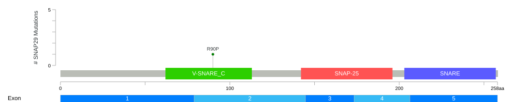
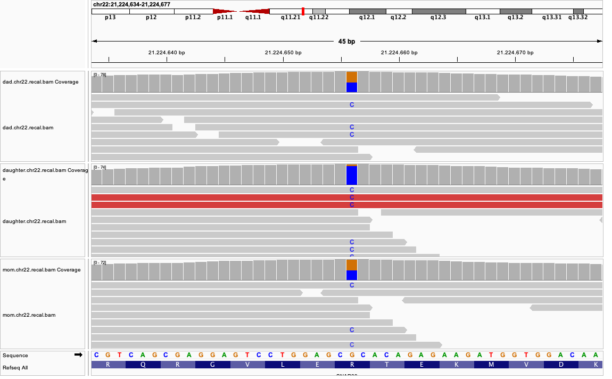
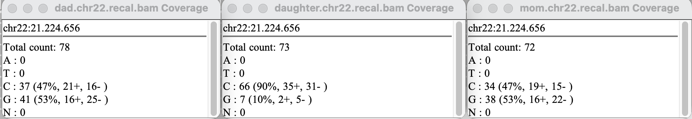
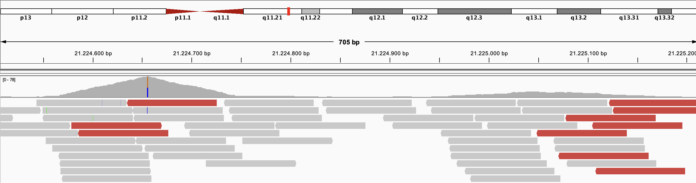
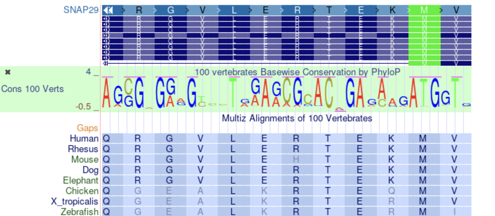
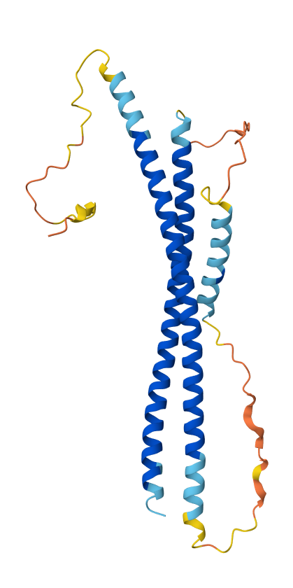
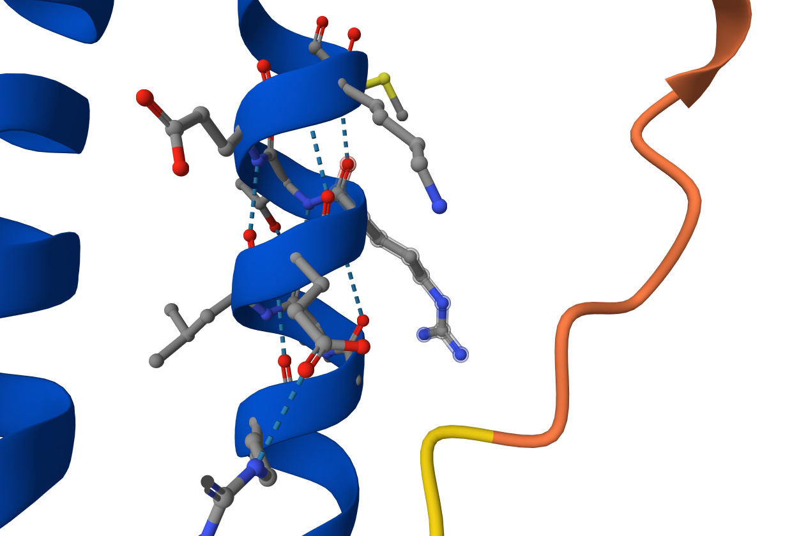
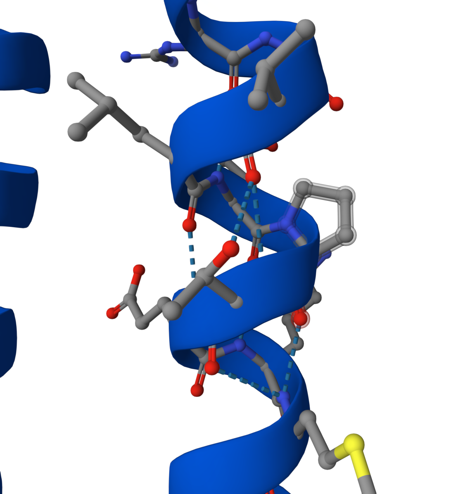

```{r libraries, include = FALSE}
#setting up libraries
library(tidyverse)
library(ggplot2)
library(gt)
library(kinship2)
library(knitr)

#load table for the variants
variants <- read_tsv("data/corpasome.trio.chr22.snps.filtered.annovar.tsv", col_types = cols(clinvar_20140702 = "c"))
```

## Introduction

Neurocutaneous syndrome, characterized by cerebral dysgenesis, neuropathy, ichthyosis, and keratoderma, or CEDNIK syndrome for short, is a autosomal recessive genetic disorder [@hsu2017cednik]. This disease is caused by a loss-of-function variant in SNAP29 (synaptosomal-associated protein 29), which encodes a SNARE protein, a vesicular membrane fusion protein [@schiller2016establishment]. Symptoms of the disease are Microcephaly, Global developmental delay, Ataxia, Ichthyosis, Diffuse palmoplantar hyperkeratosis.

This syndrome was first discovered in 2005— within the 22q11.2 region and the SNAP29 gene —using homozygosity mapping on two unrelated families with a history of consanguineous marriage that exhibited similar symptoms [@sprecher2005mutation]. In the subsequent years, up to 2021, nearly 20 variants of this syndrome were discovered [@mah2021new].

CEDNIK syndrome is an extremely rare disorder, with an estimated prevalence of less than 1 per 1,000,000 individuals; a reliable population-based incidence has not been established due to the small number of reported cases [@orphanetcednik].

Variant detection and diagnosis have become much more accessible with the advent of next-generation sequencing (NGS). Unlike earlier sequencing technologies, NGS enables the simultaneous analysis of anything from a few genes to hundreds of genes, the entire exome, or even the whole genome. NGS systems employ approaches such as whole-genome sequencing (WGS) and whole-exome sequencing (WES) [@brancato2025ngs].

In this report, we focus on WES because CEDNIK syndrome is a Mendelian monogenic disorder, which is why identifying variations within the exons alone is generally sufficient for its detection. In the case we analyzed, a 3-year-old girl exhibited symptoms of the syndrome while her parents were healthy. Therefore, our objective was to perform WES for this family of three and identify the variant by comparing the results against the reference human genome (GRCh37/hg19). This type of analytical method is known as "trio analysis" [@gabriel2022trio], and given that this syndrome is an autosomal recessive disorder, we can infer that both parents are heterozygous carriers [@hsu2017cednik].

### Study Participants/Whole exome sequencing

The base of our work is publicly available genetic data from a Spanish family, here consisting of a father, mother and their daughter, referred to as "the Corpasome" [@corpas_crowdsourced_2015]. In our case the genome of the daughter is synthetically altered and a disease phenotype called CEDNIK Syndrome, caused by these alterations, is diagnosed. Main symptoms are developmental delay and skin disorder. The latter mainfasting at the age of two in ichthyosis and thickening of palms and soles. Further, she has been diagnosed with microcephaly and poor motor development as well as impaired coordination. As Cednik Syndrome is an autosomal recessive inheritable disease and the parents are healthy, the father and mother both have one chromosome with the disease-causing variant and one without. After deciding to make their genomes publicly available, the Corpas family bought direct-to-consumer sequencing privately to collect DNA in saliva using Oragene kits. Exomes were captured with Agilent SureSelect Human All Exon (44 Mb design) and sequenced on Illumina HiSeq with an average coverage of about 30x over the target region.

```{r}
#| warning: false
#| label: fig-pedigree
#| fig-cap: "Family trio pedigree"

#draw pedigree for corpasome family
ped <- read_table("data/corpasome.ped",
                  col_names = c("family", "id", "father", "mother", "sex", "phenotype"),
                  col_types = "ccccii")

ped2 <- ped |>
  mutate(across(c(id, father, mother), str_remove, pattern = "^corpasome_"),
         father   = na_if(father, "0"),    
         mother   = na_if(mother, "0"),
         affected = as.integer(phenotype == 2)) 

pedi <- pedigree(id      = ped2$id,
                 dadid   = ped2$father,
                 momid   = ped2$mother,
                 sex     = ped2$sex,        
                 affected = ped2$affected)

plot(pedi)
```

### NGS data preprocessing

Next-Generation Sequencing (NGS) data pre-processing was used to refine and align the raw reads given to downstream Whole-Exome Sequencing (WES) analysis. The input data set comprised individual raw FASTQ (.fq) files corresponding to the family trio: mother, father, and affected child, from the Corpasome family. They are organized for each person as as paired-ends reads, 150 bp per read for R1 and R2.

Using the raw data (.fq) as an input, we can graph and see the organization of the sequences, GC percentage and the quality scores through the FastQC Report (version 0.12.1) in .fqc files. We considerate the Q scores above 30 (Q30), in acordance to the standart Illumina quality trimming sequence [@illumina].

To process the alignments, the “Burrows-Wheeler Aligner (bwa mem)”[@li2009fast] tool converts our .fq files into .bam/.sam files by comparing the qualities and positions against a reference genome; which, for this study was hg19. With the binary version (.bam), we can easly access to specific genomic regions using index files (.bai), allowing the reads of each family member to be processed and indexed efficiently in the vcf files.

A selection of variants is uptake from the comparison form specific regions identified on the .bai files from the comparison of the hg19 reference genome. To refine the search for possible SNPs, we cross-reference with the dbSNP database for hg19, allowing the algorithm to prevent confusing a real mutation with a sequencing error when re calibrating base qualities.

Using the refined regions of interest, we call GATK3 (ver 4.1.4.1) to perform variant calling on the BAM files using the "HaplotypeCaller" function. This tool performs a local de novo assembly of haplotypes in active regions, allowing it to detect both SNPs and complex indels with high precision [@gatk_haplotypecaller]. Finally, the resulting variants are stored as VCF files that could be converted into BCF.

Finally, to process the detected genetic variants, the ANNOVAR tool helped merge the resulting variant compilation into a readable table. This table in .tsv format contains genetic annotations, known identifiers, predictive scores, clinical relevance, and genomic coordinates [@wang2010annovar].

```{r}
#| label: fig-organigram
#| fig-cap: "Filtering process workflow"
#| fig-alt: "Filtering process workflow"
#| out.width: "80%"
#| warning: false

library(knitr)
include_graphics("file_organigram.jpeg")
```

### Variant annotation and filtering


## Results

### QC

```{r}
#| label: tbl-fastqc
#| tbl-cap: "FastQC Sumarized table for each read in each sample"
#| echo: false
#summarize fastqc data

# save fastqc directory
fastqc_base_dir <- "data/fastqc/"

valid_dirs <- str_subset(dir(fastqc_base_dir), "fastqc$")

processed <- read_tsv(str_c(fastqc_base_dir, 
                            valid_dirs, 
                            "/fastqc_data.txt"), 
        col_names = TRUE, 
        skip = 2, 
        n_max = 8,
        id = "file_name_long", 
        show_col_types = FALSE) |> 
  mutate(file_name = str_extract(file_name_long, "/([^/]+?)_", group = 1), .before = file_name_long) |> 
  select(!file_name_long) |> 
  pivot_wider(id_cols = file_name, names_from =`#Measure` , values_from = Value) |> 
  select(Filename, `Total Sequences`, `Total Bases`, `Sequence length`, `%GC`) 

gt(processed)
```

To begin the WES analysis, it is important to build on raw-read data that fulfills the quality requirements. By assessing the quality of the fastq file, it can be assured that later interpretation is not based on technical errors. Regarding the Corpasome data, the sequence length for all samples is as expected as well as the GC percentage with small variations in the reads of the mother displaying a percentage of 44 compared to 45% in the father and daughter. The number of total sequences as well as the number of bases measured is the same for read 1 and read 2 in each family member, whereas the number varies between different persons. The maximal difference can be found between the father and the daughter where the father has 6.3 Mbp more.

```{r}
#| label: fig-quality
#| fig-cap: "Heatmap of the quality control status performed by FastQC tool"
#| warning: false
#| echo: false

# Evaluate all QC metrics
# reads summary file from each fastqc folder and combines them in one table --> returns PASS, WARN or FAIL

# Read all summary.txt files into one long table (Status, Metric), "path" records the source file
smry <- list.files(fastqc_base_dir, pattern = "summary.txt$", recursive = TRUE, full.names = TRUE) |>
  read_tsv(col_names = c("Status", "Metric", "file"), id = "path", show_col_types = FALSE) |>
  mutate(sample = path |> 
           dirname() |> 
           basename() |>
           str_replace("^([^.]+)\\..*\\.(\\d+)_fastqc$", "\\1_\\2"), Metric = fct_rev(fct_inorder(Metric)))   

#Visualize heatmap with one tile per sample and module
ggplot(smry, aes(x = sample, y = Metric, fill = Status)) +
  geom_tile(color = "white", linewidth = 0.5) +
  scale_fill_manual(values = c(PASS = "darkgreen", WARN = "orange", FAIL = "red")) +
  labs(title = "Quality metrics per set", x = NULL, y = NULL) +
  theme_minimal()
```

This heatmap summarizes different quality metrcis across the fastqc files. For most of the metrics the data passes the quality criteria. Regarding the per tile sequence quality, all samples fail which in this case is not unusual because the corpasome data has been sequenced in 2012 [@corpas_crowdsourced_2015] while quality criteria are adapted to modern techniques.
```{r}
#| label: fig-SequenceEvaluation
#| fig-cap: "Per-base sequence quality distribution showing acceptable scores across all samples and reads."

#GC content in more detail
# read one FastQC module by name
read_module <- function(file, module) {
  lines <- readLines(file)
  start <- which(startsWith(lines, str_c(">>", module, "\t")))
  end   <- which(lines == ">>END_MODULE")
  end   <- end[end > start][1]
  read_tsv(I(str_c(lines[(start + 1):(end - 1)], collapse = "\n")),
           show_col_types = FALSE) |>
    rename_with(\(x) str_remove(x, "^#"))
}

files <- list.files(fastqc_base_dir, pattern = "fastqc_data.txt",
                    recursive = TRUE, full.names = TRUE)

gc <- files |>
  set_names() |>
  map(\(f) read_module(f, "Per sequence GC content")) |>
  list_rbind(names_to = "file") |>
  mutate(folder = basename(dirname(file)),
         sample = str_extract(folder, "^[^.]+"),  
         read   = str_c("Read ", str_extract(folder, "(\\d+)_fastqc$", group = 1))) |>
  group_by(folder) |>
  mutate(proportion = Count / sum(Count)) |>  
  ungroup()

ggplot(gc, aes(`GC Content`, proportion, colour = sample, linetype = read,
               group = folder)) +
  geom_line(linewidth = 0.8) +
  scale_x_continuous(limits = c(0, 100), breaks = seq(0, 100, 10)) +
  labs(title = "GC content distribution per sequence",
       x = "Mean GC content per read (%)", y = "Proportion of reads",
       colour = "Sample", linetype = NULL) +
  theme_minimal()
```
This graph further inspects the GC content across the three samples, since the quality metrics expressed a warning. It shows that the peak for GC contents is slightly shifted for samples of the mother. Still the distribution is the same for the two reads and the deviations between the samples are small. 

```{r qc_boxplots}
#genereate qc visualization with all pb_qual files

files <- list.files(fastqc_base_dir, pattern = "fastqc_data.txt",
                    recursive = TRUE, full.names = TRUE)

qc <- files |>
  set_names() |>
  map(\(f) read_tsv(f, skip = 13, n_max = 50, show_col_types = FALSE)) |>
  list_rbind(names_to = "file") |>
  mutate(folder      = basename(dirname(file)),
         read_set    = str_c("Read ", str_extract(folder, "(\\d+)_fastqc$", group = 1)),
         sample      = str_remove(folder, "\\.\\d+_fastqc$"),
         base_factor = factor(`#Base`, levels = unique(`#Base`)),
        panel = str_c(str_extract(folder, "^[^.]+"), "_", str_extract(folder, "(\\d+)_fastqc$", group = 1)),
         panel= factor(panel, levels = c("dad_1", "dad_2", "mom_1", "mom_2", "daughter_1", "daughter_2"))) |>
  select(!file)

qc |>
  group_by(folder) |> 
  mutate(`#Base` = factor(`#Base`, levels = `#Base`)) |> 
  
  #generate boxplot
  ggplot(aes(x = base_factor, y = Mean, fill = read_set)) +
  geom_boxplot(
    aes(
      ymin = `10th Percentile`,
      lower = `Lower Quartile`,
      middle = `Median`,
      upper = `Upper Quartile`,
      ymax = `90th Percentile`), stat = "identity", staplewidth = 0.5, width = 1) +
  
  #add threshold lines
   geom_hline(aes(yintercept = 28),
              linetype = "dashed",
              color = "orange") + 
  geom_hline(aes(yintercept = 20),
             linetype = "dashed",
             color = "red") +
   geom_line(aes(x = base_factor, y = Mean, group = read_set),
              linetype = "solid",
              color = "blue") +
  labs(title = "Quality scores across all bases", x = "Position in read (bp)", y = "Mean Quality Score") +
  theme_minimal() +
  facet_wrap(vars(panel), ncol = 2) + 
  scale_fill_discrete(name = "Folder") + 
  scale_x_discrete(breaks = seq(1, 100, 5)) + 
  coord_cartesian(ylim = c(0, 43)) +
  theme(legend.position = "none")
```

The boxplot depicts the mean quality score per position in each read separately for read 1 and read 2 in the father, mother and daughter. For each sample the last positions of some reads fall beneath the threshold of a quality score of 30 while the best quality scores are achieved for positions in the middle of the read. Especially in the reads coming from the mother, quality scores beneath 20 are achieved. However, for all positions in all samples the median remains at a quality score above 30 meaning that no reads need to be shortened for the downstream analysis. Nevertheless, it is important to remark that the samples derived from the mother show the lowest quality across different metrics.(which ones)

From the quality control regarding the raw sequencing data, there is no detectable issue that would affect further analysis. Furthermore, in the following steps, more metrics will be assessed to assure correct variant calling.

### Sample processing

```{r}
#summarize preprocessing 

bam_stats <- read_delim("data/bam_statistics.txt", col_names = c("nreads", "file"),  delim = " ", show_col_types = FALSE)

step_labels <- c(
  "bam"         = "Aligned and sorted",
  "markdup.bam" = "Duplicates removal",
  "realn.bam"   = "Indel realignment",
  "recal.bam"   = "Base quality recalibration"
)

bam_base <- bam_stats |>
  mutate(person   = str_extract(file, "^\\w+"),
         bam_step = str_extract(file, "\\D+$"),
         bam_step = str_remove(bam_step, "^\\.")) |>
  pivot_wider(id_cols = -file, names_from = person, values_from = nreads) |>
  rename(Filename = bam_step) |>
  mutate(description = unname(step_labels[Filename]), .after = Filename)

removed_row <- bam_base |>
  filter(Filename %in% c("bam", "recal.bam")) |>
  summarise(across(c(dad, mom, daughter),
                   \(x) x[Filename == "bam"] - x[Filename == "recal.bam"])) |>
  mutate(Filename = "",
         description = "Removed (total)",
         .before = dad)

pct_row <- bam_base |>
  filter(Filename %in% c("bam", "recal.bam")) |>
  summarise(across(c(dad, mom, daughter),
                   \(x) round(100 * (x[Filename == "bam"] - x[Filename == "recal.bam"]) /
                                x[Filename == "bam"], 1))) |>
  mutate(Filename = "",
         description = "Removed (%)",
         .before = dad)


bam_table <- bind_rows(bam_base, removed_row, pct_row) 

gt(bam_table)

#add summary rows below
removed <- bam_table |> filter(description == "Removed (total)")
pct     <- bam_table |> filter(description == "Removed (%)")

pct_range <- range(unlist(pct[, c("dad", "mom", "daughter")]))

#to format numbers in text 
fmt <- \(x) format(x, scientific = FALSE, big.mark = ",", trim = TRUE)
```

The table displays the different steps of sample processing and the effect on the number of alignments. As expected, only the duplication removal reduces the number of records. In total `r fmt(removed$dad)` alignments have been removed in the sample of the dad, `r fmt(removed$mom)` for the mom and `r fmt(removed$daughter)` for the daughter, which is in a range of `r pct_range[1]`% to `r pct_range[2]`% of all alignments in the unprocessed file.

### Variant calling/filtering

To begin the variant calling, the raw file includes all covered positions in exons which could potentially contain variants. It includes all three samples and displays 1,418,395 positions. After the variant calling 8,803 of these positions are defined as SNPs in the bcf file which is about 0.62% of the positions in the raw file. To refine the variant calling, positions with a read depth below 20 are removed. 5,898 positions remain in the vcf file. These are 5,983 variants if multi-allelic sites are considered and split in separate rows. This process is also called demultiplexing. Further conversion to tsv and annotation using ANNOVAR, does not change the number of variants. The resulting file with 5,983 variants can now be used for downstream analysis and filtering of possible disease-causing variants.

```{r}
#Analyse transition/transversion ratio and nonsynonymous/synonymous ratio

ts_tv <- variants |> 
  filter(str_detect(Ref, "^[ACTG]$"), str_detect(Alt, "^[ACTG]$")) |>
  group_by(Ref, Alt) |> 
  summarise(Count = n(), .groups = "drop") |> 
  mutate(Type = case_when(
    (Ref == "A" & Alt %in% c("G")) | (Ref == "G" & Alt %in% c("A")) | 
    (Ref == "C" & Alt %in% c("T")) | (Ref == "T" & Alt %in% c("C")) ~ "Transition",
    TRUE ~ "Transversion")) |> 
  arrange(Type, Ref, Alt)

gt(ts_tv)

syn_nonsyn <- variants |> 
  filter(ExonicFunc.refGene %in% c("synonymous SNV", "nonsynonymous SNV")) |> 
  group_by(ExonicFunc.refGene) |> 
  summarise(Count = n()) |> 
  mutate(Type = case_when(
    ExonicFunc.refGene == "synonymous SNV" ~ "Synonymous",
    TRUE                                   ~ "Nonsynonymous")) |> 
  ungroup() |> 
  select(Type, Count) |> 
  arrange(Type)

gt(syn_nonsyn)

#Transition/transversion
n_ts <- sum(ts_tv$Count[ts_tv$Type == "Transition"])
n_tv <- sum(ts_tv$Count[ts_tv$Type == "Transversion"])
ts_tv_ratio <- round(n_ts / n_tv, 2)

#Nonsynonymous/synonymous
n_syn    <- syn_nonsyn$Count[syn_nonsyn$Type == "Synonymous"]
n_nonsyn <- syn_nonsyn$Count[syn_nonsyn$Type == "Nonsynonymous"]
nonsyn_syn_ratio <- round(n_nonsyn / n_syn, 2)
```

Besides ensuring sufficient read depth, the transition-transversion ratio as well as the nonsynonymous/synonymous SNP ratio are quality metrics to control for correct variant calling Since transitions require less energy, the ratio of transition-transversion is expected to be \> 2 which is also reflected in the data presenting a ratio of `r ts_tv_ratio`. Regarding the nonsynonymous/synonymous SNP ratio a 1 to 1.2 ratio is usual. Our data presents a ratio of `r nonsyn_syn_ratio`.

The tables below provide further information about the location and effect of the variants. Regarding the location, about two third of the variants are located in intergenic or intronic regions. Exonic variants follow with a sixth of all variants. To get a deeper look in the extronic variants, table 2 shows that almost half of the variants are synonymous meaning that the resulting aminoacid does not change in the protein.

```{r variant_types}
#summarize and count annotated positions of all variants within the genome
variants |> 
  count(Func.refGene) |> 
  arrange(desc(n))|>
  gt()
```

```{r exonic_variants}
#for exonic variants, summarize effects of variants on gene codons

variants |> 
  filter(Func.refGene == "exonic") |> 
  count(ExonicFunc.refGene)|>
  gt()
```

To identify the disease-causing variant, a comparison with the parental genomes is useful to find a possible recessive pattern. Out of the 5,983 variants, 153 were found to be recessive. Additionally, a filter is applied to discard common variants which in this case in only one variant. Since exonic variants are the most probable kind of variant to alter the gene product namely the protein, they are of biggest interest in this case report. The next filtering step removes all nonexonic variants and further filtering is applied to remove synonymous variants as well as nonframeshift deletions or insertions because their effect on the protein is usually not pathogenic. Finally, 23 variants in 11 different genes are left.

```{r}
#filtering of variants
recessive <- variants |> 
  filter(corpasome_dad == "01") |> 
  filter(corpasome_mom == "01") |> 
  filter(corpasome_daughter == "11")

noncommon <- recessive |>
  filter(is.na(esp6500si_ea)       | esp6500si_ea > 0.05,
         is.na(`1000g2012apr_eur`) | `1000g2012apr_eur` > 0.05)

effective <- noncommon |> 
  filter(Func.refGene == "exonic") |> 
  filter(ExonicFunc.refGene %in% c("nonsynonymous SNV", "frameshift deletion", "frameshift insertion", "stopgain", "stoploss"))

effective |> 
  select(Chr, POS, Ref, Alt, Gene.refGene, ExonicFunc.refGene)|>
  gt()

tibble(
  Filtering = c("All variants", "Recessive", "Noncommon", "Deleterious"),
  Variants = c(nrow(variants), nrow(recessive), nrow(noncommon), nrow(effective)),
  Genes = c(n_distinct(variants$Gene.refGene),
          n_distinct(recessive$Gene.refGene),
          n_distinct(noncommon$Gene.refGene),
          n_distinct(effective$Gene.refGene))
) |>
  gt()

```

```{r}
#same for denovo
# denovo <- variants |> 
#   filter(corpasome_dad == "00") |> 
#   filter(corpasome_mom == "00") |> 
#   filter(corpasome_daughter == "01")
# 
# noncommon_dn <- denovo |>
#   filter(is.na(esp6500si_ea)       | esp6500si_ea > 0.05,
#          is.na(`1000g2012apr_eur`) | `1000g2012apr_eur` > 0.05)
# 
# effective_dn <- noncommon_dn |> 
#   filter(Func.refGene == "exonic") |> 
#   filter(ExonicFunc.refGene %in% c("nonsynonymous SNV", "frameshift deletion", "frameshift insertion", "stopgain", "stoploss"))
# 
# effective_dn |> 
#   select(Chr, POS, Ref, Alt, Gene.refGene, ExonicFunc.refGene)|>
#   gt()
```


In order to select the disease-causing gene out of these 11 candidate genes, the varsome database [@kopanos_varsome_2019] is used to evalute related phenotypes. Some of these genes are not associated with a disease phenotype (CCT8L2, ZNF280A) or related with different types of cancer (ATP6V1E1, MED15, RFPL2, XRCC6, NHP2L1, ATP5L2. BRD1, ZBED4). The SNAP29 gene, however, is related to the CEDNIK syndrome - an autosomal recessive inherited disease. Furthermore, related HPO terms, namely ichthyosis, palmoplantar keratoderma and neurophathy, match with the described symptoms of the patient.

- How many variants were finally called over all samples and annotated using ANNOVAR? How many variants remaining after each filtering step (1 or 2 tables)? Describe impact of each filtering step by number of qualifying variants.
- How many exonic/intronic variants were called? (1-2 sentences, 1 table). Were there any variants related to alternative splicing?
- How many different exonic variant types (nonsynonymous/synonymous/frameshift/non-frameshiftindels/etc) were called? (1-2 sentences, 1 table).
- QC measures: calculate and discuss
  - transistion/transversion ratio WGS, WES?
  - nonsynonymous/synonymous ratio

### Analysis of the candidate gene

```{r}
#show position of variant in the protein

```

The identified variant can be found at position 90 where arginine is exchanged by proline due to a transition from guanine to cytosine at position 21,224,656 in the chromosome 22. Using the UCSC liftover tool the variant at the position chr22:21224656 in the hg19 reference genome could be mapped to chr22:20870368 in the hg38 genome [@casper_ucsc_2026]. This is useful to search databases including both genomes to find also newly added findings relying on the hg38 genome. The nomenclature used for database search is chr22:g.21224656G>C on genomic level refering to hg19, c.269G>C on cDNA level and p.Arg90Pro for protein level.

```{r}
#show variant in igv including coverage metrics


```

At the variant position, the read depth is sufficient for a reliable genotype call in all three samples with 78 reads covering the position in the father, 72 in the mother and 73 in the daughter. Both parents are heterozygous and show a similar allele ratio of about 53 % guanine and 47 % cytosine. The daughter is homozygous for the alternative allele, with 90 % of her reads showing cytosine. This is consistent with a recessive mode of inheritance, because both parents are unaffected carriers and the affected child has two copies of the variant. Remarkably, about 10 % of the daughter’s reads show guanine. This is unlikely to reflect a true second allele, but rather shows a technical artefact, such as sequencing errors, misaligned reads or even a contamination with parental DNA.

```{r}
#extract coverage

samples    <- c("dad", "mom", "daughter")
chromosome <- "chr22"
position   <- 21224656      #position for the variant of interest
gene       <- "SNAP29"      #gene of interest

# read one DepthOfCoverage output type for all samples and stack them
read_doc <- function(suffix, n_max = Inf) {
  samples |>
    set_names() |>
    map(\(s) read_tsv(file.path("data/coverage", str_c(s, ".depthOfCoverage.txt", suffix)),
                      n_max = n_max,
                      na = c("", "NA", "N/A"), show_col_types = FALSE) |>
    rename_with(\(x) str_remove(x, "^corpasome_[a-z]+_"))) |>
    list_rbind(names_to = "sample")
}

sample_summary <- read_doc(".sample_summary", n_max = 1) 

gene_summary <- read_doc(".sample_gene_summary") |>
  rename_with(\(x) str_remove(x, "^corpasome_[a-z]+_")) |>
  filter(Gene == gene)

interval <- read_doc(".sample_interval_summary") |>
  mutate(chr   = str_match(Target, "^([^:]+):")[, 2],
         start = as.integer(str_match(Target, ":(\\d+)")[, 2]),
         end   = as.integer(str_match(Target, "-(\\d+)$")[, 2]),
         end   = coalesce(end, start)) |>
  filter(chr == chromosome, start <= position, position <= end)

depth_at_pos <- samples |>
  set_names() |>
  map(\(s) read_tsv(file.path("data/coverage/", str_c(s, ".depthOfCoverage.txt")),
                    show_col_types = FALSE) |>
         filter(Locus == str_c(chromosome, ":", position)) |>
         rename(depth = starts_with("Depth_for_"))) |>
  list_rbind(names_to = "sample")

sample_summary |>
  select(sample, chr22_mean = mean) |>
  left_join(gene_summary |> select(sample, gene_mean = mean_cvg), by = "sample") |>
  left_join(interval |> select(sample, exon_mean = mean_cvg, exon_pct_20x = `%_above_20`),
            by = "sample") |>
  left_join(depth_at_pos |> select(sample, depth_at_position = depth), by = "sample") |> 
  gt()
```

The table above summarizes the coverage from the whole chromosome narrowed down to the gene, exon and particular position of the candidate variant. It seems that the coverage of the chromosome and the gene is very little, but since the data is based on WES the high percentage of introns distort the calculated numbers. Thus, it is important to consider exon sequencing only and include the coverage of the particular position. Taking this into account the sequencing depth covering the interval of `r -21224626+21225329` nucleotides containing the candidate variant is above 12x for all three samples and around 21 % of all positions in the considered interval present a coverage above 20x making the called nucleotides highly reliable. At the considered position which is in the middle of the exon, the coverage is above 70x allowing further analysis based on the sequenced nucleotides. In our case it is important to mention that these high coverage values are caused by the synthetic introduction of the variant rather than showing real sample reads. 

```{r}
#visualize coverage in intervall of the candidate variant

pos_cov <- samples |>
  set_names() |>
  map(\(s) read_tsv(file.path("data/coverage/", str_c(s, ".depthOfCoverage.txt")),
                    col_types = cols(.default = col_character()),
                    show_col_types = FALSE) |>
         mutate(pos = as.integer(str_extract(Locus, "(?<=:)\\d+"))) |>
         filter(between(pos, interval$start[1], interval$end[1])) |>
         rename(depth = starts_with("Depth_for_")) |>
         mutate(depth = as.integer(depth))) |>
  list_rbind(names_to = "sample")

ggplot(pos_cov, aes(pos, depth, colour = sample)) +
  geom_line() +
  geom_vline(xintercept = position, linetype = "dashed") +
  labs(x = "Position on chr22", y = "Depth (x)", colour = NULL)

#show igv graphic for comparison

```
To better visualize the coverage at the relevant interval the graphic above depicts the sequencing depth per position separately for each sample. The dotted line represents the variant position. Interestingly, the interval extracted from annotated file does not represent the exonic region containing the variant but also shows intronic regions where read depth drops to 0x. The highest peak with values above 70x can be observed at the target positions which aligns well with the previous findings in the table. Further the neighboring regions has a good coverage allowing reliable variant calling. Still, this graphic shows that correct annotations of genomic regions are important for correct interpretation and there is the need to control for correct annotation. As a reference the whole region, here using the father's sample, can be observed in igv showing the coverage of the exon containing the variant on the left and a second exon further downstream resulting in the second lower peak of higher coverage values in the diagram. These values reflect the natural range of sequencing depth as there has not been a synthetic alteration.

The variant 22-21224656-G-C has not been reported in the population database gnomAD which hints towards an extremely rare variant [@guez_integrating_2026]. This finding fits well with the observed phenotype as the CEDNIK syndrome is a very rare disease. At this position, variants of G-A and G-T have been reported, but also with a very rare allele frequency which underlines the hypothesis further. In gnomAD, SNAP29 shows no depletion of missense variants (expected: 148.1, observed 178, o/e 1.20, Z = -0.87). For predicted loss-of-function variants, 12.2 SNVs would be expected and 5 have been observed [@guez_integrating_2026]. This could point to weak depletion, but with so few observed variants the estimate is imprecise, and the data do not provide convincing evidence of constraint. This pattern is expected for a gene associated with an autosomal recessive disorder because heterozygous carriers are unaffected meaning that deleterious alleles are not strongly selected against and can persist with a low frequency in the population. In conclusion, these findings do not support nor argue against the candidate gene. Additionally, these metrics conclude on the whole gene and cannot distinguish between different variants. Consequently, further evaluation with data specific for the detected variant is necessary.

This can be done using varsome [@kopanos_varsome_2019]. Again, the exact variant cannot be found, but predictions done by AlphaMissense and EVE show that this variant is potentially “pathogenic moderate”. Furthermore, the PhastCons100way conservation score of 1.000 and the PhyloP100way score of 4.218 underline that this nucleotide is highly conserved across different vertebras and thereby, probable to be pathogenic if altered.

```{r}
#show conservation in the region of the variant

```
This visualization from the UCSC Genome Browser [@casper_ucsc_2026] shows how conserved this position and neighboring nucleotides and amino acids are across different species. The database further depicts the different tissues where SNAP29 is expressed. As the protein is related to fusion of cellular membranes for example during autophagy [@the_uniprot_consortium_uniprot_2025], it is expressed in a variety of tissues. Beneath them, brain, skin and skeletal muscle which are affected in the case of the reported child. This enhances SNAP29 being the relevant cause for the observed symptoms. Besides that, other variants within SNAP29 have been reported to be causative for the CEDNIK syndrome [@the_uniprot_consortium_uniprot_2025]. Some examples are a missense variant exchanging glutamate to lysine at position 89, the depletion of leucine at position 119 or methione to valine at position 184. The variant R90P lies within the C-terminus of the Snare region which is anchored in the vesicle membrane [@gao_integrative_2013] [@cerami_cbio_2012] [@de_bruijn_analysis_2023]. This region builds an alpha helix. Since the exchanged amino acid is an arginine which supports alpha helical structures to a proline which is known to be incompatible with helical structures due to its missing NH-structure due to its ring formation [@berg_zusammensetzung_2026]. The protein folding is assumed to be disturbed. The framework of Franklin suggests a classification of VUS for the variant naming low frequencies in gnomAD population databases and in-silico predictions supporting deleterious effects [@noauthor_franklin_nodate]. 

```{r}
#show structure of SNAP29

```


```{r}
#zoom. in on structure at variant position


```
The protein structure derived using the AlphaFold Protein Structure Database [@jumper_highly_2021] shows the exact position of Arg90 in the alpha helix in the SNARE region. A predicted model of p.Arg90Pro does not show a break in the helix as expected. However, AlphaFold was not designed to predict effects of single substitutions and in the cell, the structure might still be destabilised or different from the prediction. 


- Annotate your variant with more scores and annotation using [wANNOVAR](http://wannovar.wglab.org/) and discuss if they support the hypothesis that the variant is disease causing
- Collect data about your variant and gene and the position of your variant from GeneCards, Uniprot, OMIM, GTEX. Is the variant located in a certain protein domain, does it is region where other disease-causing variants are located, is the protein/gene expressed in the tissue that you would expect?
- Use different tools for variant interpretation like MutationMapper, MuPIT, MTR-viewer, VSranker, ClinVar


## Discussion

In this study, Whole Exome Sequencing (WES) trio data from the Corpasome family were processed and analyzed to identify the genetic cause of a severe neurocutaneous disorder observed in a 3-year-old female patient. Following a bioinformatics workflow that included raw FASTQ quality control, alignment to the hg19 reference genome using BWA-MEM, duplicate removal, base quality recalibration, and variant calling with GATK3 HaplotypeCaller, a total of 5,983 variants were identified across all family members and annotated using ANNOVAR. Subsequent functional filtering and inheritance model-based prioritization steps successfully isolated a causative missense variant (p.Arg90Pro) in the SNAP29 gene, located at position 21,224,656 on chromosome 22 (G>C). The mode of inheritance for this variant and the associated CEDNIK syndrome is well-known to be autosomal recessive, which was confirmed by observing that both healthy parents are heterozygous carriers while the affected patient is homozygous for the variant.

To support the hypothesis that we have identified the true causative variant, several lines of converging evidence were established. First, sequential bioinformatic filtering, moving from 5,983 total variants down to 11 candidate genes and 23 variants, isolated the SNAP29 missense variant (p.Arg90Pro) based on an autosomal recessive inheritance model and rarity criteria. Second, the variant is completely absent from the gnomAD population database, confirming its extreme rarity in concordance with the prevalence of CEDNIK syndrome. Third, high-stringency quality metrics and coverage analysis demonstrated that the variant position is exceptionally well-covered with more than 70x read depth across all family members, with the affected child being homozygous for the variant allele and both parents acting as heterozygous carriers, as visualized clearly in IGV. Finally, cross-referencing with HPO terms and VarSome demonstrated that SNAP29 is uniquely linked to CEDNIK syndrome features such as microcephaly, ichthyosis, and palmoplantar keratoderma, whereas all other candidate genes are either unassociated with disease or linked exclusively to cancer pathways. 

Although the evidence supports SNAP29 p.Arg90Pro as a plausible cause, three points need further discussion. A primary limitation of this case study is the inherent scope of WES, which restricts the analysis to protein-coding regions while entirely omitting non-coding elements such as promoters and enhancers. Consequently, potential regulatory mutations or variants in these regions remain undetected. Subsequent Whole Genome Sequencing (WGS) could clarify whether the identified SNAP29 variant is the only causative factor underlying the disease phenotype. In addition to that, the variant position the daughter's the coverage is high, but out of 73 reads seven are  showing guanine instead of the variant cytosine which rises the question whether the daughter is in fact homozygous or if this observation is due to the artificial nature of the introduced variant. Ideally, the variant position could be confirmed by Sanger sequencing of the daughter and both parents. Besides that, the consequences of the amino acid exchange at the protein and cellular level are unknown, since the variant has not been reported before. Does the proline distort the alpha helical structure within the SNARE region? Is the mutant SNAP29 still able to assemble into SNARE complexes? To what extend does this effect cellular processes resulting in epidermal and neuronal symptoms? 

To address these open questions, further experiments could be conducted. Building on published work on SNAP29 deficiency, integrin recycling in healthy and SNAP29 p.Arg90PRO cells could be studied. Integrin is important in cell migration and therefore pivotal for epidermal differentiation and neuronal development [@gambardella_multifaceted_2003] [@cayre_cell_2009]. In a pulse-chase experiment, accumulation of β-integrin in SNAP29 deficient cells could be observed which could over time cause the CEDNIK-associated symptoms [@rapaport_loss_2010]. Interestingly, SNAP29-mutated zebrafish have a smaller head size mirroring microcephaly in humans [@mastrodonato_genetic_2019]. This would be a meaningful experiment to see consequences even on the organism level. Another possibility would be to derive primary fibroblasts from the daughter and study SNAP29 protein interaction using immunoprecipitation or an autophagic assay to asses functionality of p.Arg90Pro SNAP29. Performing a rescue experiment would confirm whether the SNAP29 variant is the cause of the observed results.

In conclusion, the genetic findings are consistent with the clinical picture. The genotype pattern fits autosomal recessive inheritance, SNAP29 is an established CEDNIK gene, and the patient’s symptoms match the syndrome. However, p.Arg90Pro is a missense variant without functional evidence. Within the ACMG framework it is therefore likely to remain a variant of uncertain significance until functional or additional genetic data are available. The experiments outlined above would be the next steps towards clarifying its role.


## References
